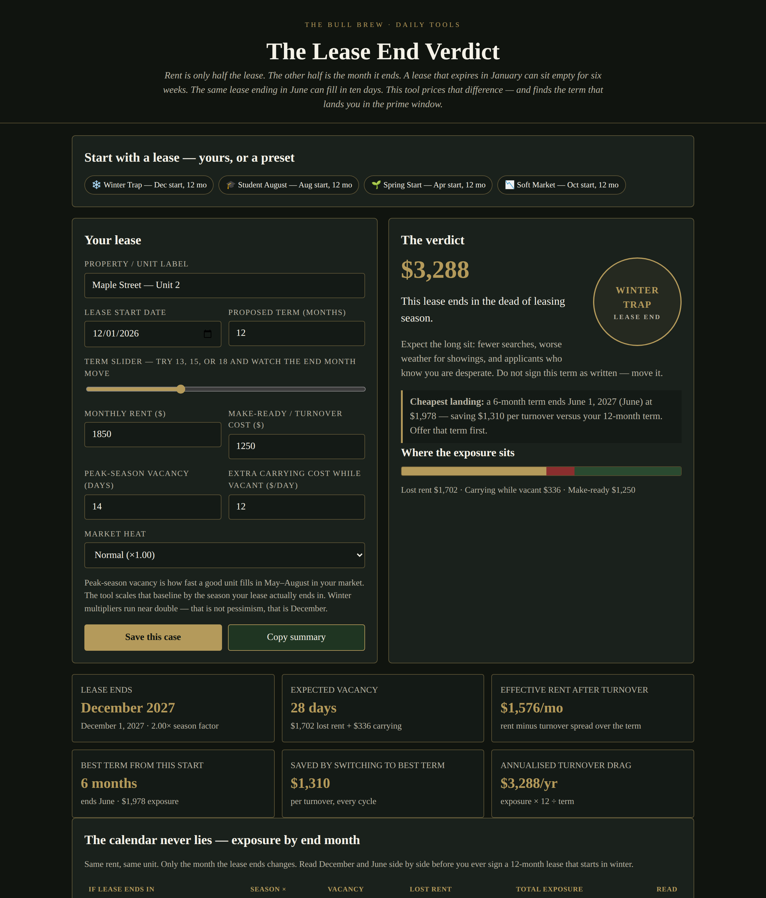

# The Lease End Verdict

**Live:** https://thebullbrew.github.io/lease-end-verdict/
**Repo:** https://github.com/thebullbrew/lease-end-verdict

## What it does

Rent is only half a lease. The other half is the month it ends. The Lease End Verdict prices the season your lease lands in: enter a start date, proposed term, rent, make-ready cost, your peak-season vacancy baseline, carrying cost while vacant, and market heat. You get the lease end date, expected vacancy days, total turnover exposure, effective rent after turnover, and a gold-style seal verdict — PRIME WINDOW / WORKABLE / SHOULDER SEASON / WINTER TRAP.

It also scans every term from 6 to 24 months and solves the cheapest landing, shows what switching to that term saves per turnover, maps exposure for every possible end month (January through December) in one calendar table, and saves cases in your browser with a one-tap copy summary for a tenant negotiation or your files.

## The method behind it

- **Turnover is seasonal, rent is not.** Landlords negotiate rent to the dollar, then accept any end date. This tool reverses that: vacancy is scaled by season — January at 2.10× and December at 2.00× your peak baseline, down to June–July at 0.70× — then priced in lost rent plus daily carrying cost plus make-ready.
- **The fix is term, not hope.** You usually cannot move a move-in date, but you can offer 13, 15, or 18 months on the first term so every renewal lands in the prime window. The term scan makes that move visible in dollars.
- **Student landlords already know this.** August-to-August is prime by design. This gives every other landlord the same discipline — and a number to bring when a tenant asks for the term that lands you in the trap.
- **Honest defaults.** Multipliers are planning defaults, scaled by a hot / normal / soft market pick. Set the peak-season baseline from your own last three fills for the sharpest read.

## How to run

Open `docs/index.html` in any browser, or serve the `docs/` folder with any static host. It is a fully self-contained single-page app with a minimal PWA shell (manifest + service worker) — no backend, no build step, no accounts, and every calculation happens locally on your device.

*Design: Dark aesthetic variation 1 — Midnight Ledger (near-black green, antique gold hairlines, hunter-green primary buttons, gold numerals).*
